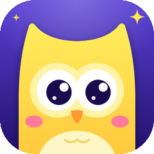
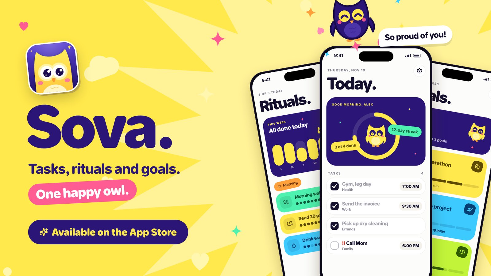
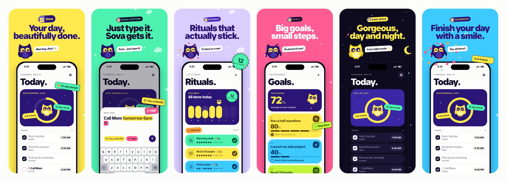

<div align="center">



# Sova

**Tasks, rituals and goals. One happy owl.**

A native iPhone app for planning your day, keeping your habits and reaching big goals,<br>
built entirely with SwiftUI for iOS 26 and Liquid Glass.

[](#requirements)
[](#built-with)
[](#widgets-and-siri)
[](https://0xpranayyy.github.io/sova/privacy.html)

[**Website**](https://0xpranayyy.github.io/sova/) &nbsp;·&nbsp;
[**Press kit**](https://0xpranayyy.github.io/sova/press.html) &nbsp;·&nbsp;
[**Support**](https://0xpranayyy.github.io/sova/support.html) &nbsp;·&nbsp;
[**Privacy**](https://0xpranayyy.github.io/sova/privacy.html)

<br>



</div>

<br>

## Contents

- [Why Sova](#why-sova)
- [Screens](#screens)
- [Features](#features)
- [Design](#design)
- [The little things](#the-little-things)
- [Built with](#built-with)
- [Getting started](#getting-started)
- [Project structure](#project-structure)
- [Publishing](#publishing)
- [Credits](#credits)

<br>

## Why Sova

Most people juggle a to-do app, a habit tracker and a note full of goals. Sova puts all three on one screen, and makes finishing your day feel like something.

<table>
<tr>
<td width="33%" valign="top">

### ✏️ Just type it
Write `Call Mom tomorrow 6pm !!` and Sova fills in the day, the time and the priority. Add `every Monday` and it repeats.

</td>
<td width="33%" valign="top">

### 🔁 Rituals that stick
Habits on the days you choose, grouped by morning, afternoon and evening, with streaks that rest days don't break.

</td>
<td width="33%" valign="top">

### 🏁 Big goals, small steps
Give a goal a deadline, break it into steps and link tasks to it. Every step you tick moves the percentage.

</td>
</tr>
</table>

<br>

## Screens

<p align="center">
  
</p>

<br>

## Features

| | |
| :-- | :-- |
| **Today** | A greeting, the owl inside a ring that fills as you finish things, one **Up Next** card, today's rituals as sticker tiles, overdue and open tasks, and what you've done |
| **Tasks** | Natural-language capture, repeats (daily, weekdays, weekly, monthly, yearly), alerts at the time or a few minutes before, swipe to finish or push to tomorrow, and Undo everywhere |
| **Rituals** | Weekday schedules, morning / afternoon / evening / anytime groups, 🔥 streaks and a week view on an indigo stage |
| **Goals** | Deadlines, numbered steps, linked tasks, a big percentage and archiving |
| **Insights** | This week's bars, a 17-week activity calendar and which rituals you keep most |
| **Editors** | Every task, ritual and goal is made on a live sticker preview, with quick choices instead of form rows |
| **Widgets** | Today, **My Day** (large, with tasks and rituals you tick right there), Rituals and Lock Screen |
| **Siri** | "Add a task in Sova", "Tick off a ritual in Sova", "Show my day in Sova", plus Shortcuts |
| **Sova Plus** | Free has unlimited tasks, 5 rituals and 3 active goals. Plus unlocks unlimited rituals and goals, iCloud sync and extra icons. Monthly, yearly with a 7-day trial, or lifetime |
| **Private** | No account, no tracking, no ads. Data stays on the iPhone, or in your own iCloud if you turn on sync |

### Widgets and Siri

| Widget | Sizes | What's on it |
| :-- | :-- | :-- |
| **Today** | Small, medium | The owl in its ring, Up Next with its time, progress and streak |
| **My Day** | Large | The owl, a greeting, your week, the next tasks with working checks, and ritual stickers |
| **Rituals** | Medium, large | Sticker tiles you tick from the Home Screen |
| **Lock Screen** | Circular, rectangular, inline | Progress and what's next |

Every widget reads well on tinted and clear Home Screens and on StandBy.

<br>

## Design

Bold, warm and colorful, built on the palette and typeface of [Allo](https://allo.joshpuckett.me/).

<table>
<tr>
<td align="center"><br><sub><b>Yellow</b><br><code>FFE94D</code></sub></td>
<td align="center"><br><sub><b>Mint</b><br><code>4DF2B0</code></sub></td>
<td align="center"><br><sub><b>Lilac</b><br><code>D9CEFF</code></sub></td>
<td align="center"><br><sub><b>Pink</b><br><code>FF5C93</code></sub></td>
<td align="center"><br><sub><b>Orange</b><br><code>FFA03A</code></sub></td>
<td align="center"><br><sub><b>Cyan</b><br><code>3DCBFF</code></sub></td>
<td align="center"><br><sub><b>Lime</b><br><code>C2F53A</code></sub></td>
<td align="center"><br><sub><b>Indigo</b><br><code>2B1677</code></sub></td>
</tr>
</table>

- **Flat sticker blocks.** Each color sits on a near-white page, with text in a deep shade of the same color, so every block reads as one piece.
- **Allo, set big.** Heavy titles that end with a period (*Today.* *Goals.* *Rituals.*), small caps labels with open tracking, and big heavy numbers.
- **Big, friendly buttons.** 60-point rounded blocks with heavy text, and checkboxes in the color of their ritual.
- **The owl.** Belly, wings, orange feet and pink cheeks. It blinks, glances around, follows your finger and smiles when your day is done. At night it becomes a glowing yellow owl on deep indigo.
- **Liquid Glass** only where Apple puts it: the tab bar, sheets and the Undo bar.

<br>

## The little things

<details>
<summary><b>Motion</b></summary>
<br>

- The owl breathes, double-blinks, leans toward where it's looking, and hops and flaps when you poke it.
- Finishing your whole day or a goal bursts sparkles outward on springs while the owl celebrates.
- Two waves, used sparingly ([Distortion Waves](https://github.com/Jakubantalik/Libraries.dev)): one rises from **Open Sova** into your first Today, and once a day a ring opens from the owl into a **Day done!** summary.
- Buttons squish when pressed, ritual tiles wiggle when ticked, and checkmarks draw themselves in.
- Everything becomes a simple crossfade with Reduce Motion.

</details>

<details>
<summary><b>Haptics</b></summary>
<br>

- A soft press on every big button, and a tick when switching tabs
- A success tap when you check something off, and a warning buzz on delete
- A crisp pop for "move to tomorrow"
- "Pop pop pop" as the welcome stickers land
- A tick when quick capture recognizes a date or priority

</details>

<details>
<summary><b>Sound</b></summary>
<br>

Tiny tones made in code, with no audio files: a rising ding when you check something off, a soft low note when you uncheck it, an arpeggio when the day is done, and a "hoo-hoo" when you poke the owl. They follow the silent switch, mix with your music and can be turned off.

</details>

<details>
<summary><b>Onboarding</b></summary>
<br>

1. **Welcome.** The owl on an indigo stage, with stickers of a Sova day popping in around it.
2. **How it works.** Tasks, rituals and goals, with a live task you can tick.
3. **Your name.** The owl asks in a speech bubble and smiles when you answer.
4. **Rituals.** Pick up to three; each becomes a real ritual.
5. **A goal.** Write your own or pick a suggestion.
6. **Reminders.** A preview of the real notification, then morning and evening times.
7. **All set.** Your rituals, reminders and goal, with the owl celebrating.

Onboarding creates only what you choose. There's no sample data. After that, TipKit teaches quick capture and swiping.

</details>

<details>
<summary><b>Accessibility</b></summary>
<br>

Reduce Motion everywhere, VoiceOver labels on checks and cards, light and dark appearance, and haptics and sounds that can each be turned off.

</details>

<br>

## Built with

| | |
| :-- | :-- |
| **UI** | SwiftUI, Liquid Glass, Metal shaders, TipKit |
| **Data** | SwiftData in an App Group store shared with the widgets, with CloudKit mirroring for Plus members who turn on sync |
| **System** | WidgetKit (interactive), App Intents (Siri and Shortcuts), UserNotifications, StoreKit 2 |
| **Sound** | AVAudioEngine, with every tone synthesized |
| **Packages** | [DistortionWavesKit](https://github.com/Jakubantalik/Libraries.dev), pinned to a fixed revision |

<br>

## Getting started

### Requirements

- Xcode 26 or later, with the **Metal Toolchain** component (Xcode → Settings → Components)
- iOS 26 or later

### Run

1. Open `Sova.xcodeproj`. Xcode fetches the Swift package by itself.
2. In **Signing & Capabilities**, choose your team for both **Sova** and **SovaWidgetsExtension**.<br>
   Xcode then registers the App Group `group.app.sova.Sova`, the iCloud container `iCloud.app.sova.Sova` and Push Notifications.
3. Run the **Sova** scheme. It uses `Sova.storekit`, so you can try purchases in the simulator without App Store Connect.

If Xcode says the Metal Toolchain isn't installed, run this once:

```bash
xcodebuild -downloadComponent MetalToolchain
```

> [!TIP]
> The project uses Xcode's synchronized folders, so new files under `Sova/`, `Shared/` or `SovaWidgets/` are picked up automatically. A `project.yml` for [XcodeGen](https://github.com/yonaskolb/XcodeGen) is included too.

<br>

## Project structure

```
Sova/                 the app
├── App/              entry point, root view, tabs and routing
├── Features/         Today, Goals, Rituals, Insights, editors, onboarding, Plus, settings
├── Components/       the owl, stickers, checkboxes and shared views
├── Theme/            type, surfaces and button styles
├── Models/           starter content for onboarding
├── Intents/          Siri phrases
└── Support/          haptics, sounds, waves, purchases, links

Shared/               used by the app and the widgets
├── Models/           tasks, rituals, goals and steps
├── Store/            the shared SwiftData store
├── Intents/          Siri and widget actions
└── Theme/            palette, sticker tones and fonts

SovaWidgets/          Today, My Day, Rituals and Lock Screen widgets
Config/               entitlements and Info.plist keys
docs/                 the website on GitHub Pages
marketing/            launch film, App Store screenshots, banners and listing copy
```

<br>

## Publishing

Everything for the App Store lives in [`marketing/app-store`](marketing/app-store):

| File | What it's for |
| :-- | :-- |
| [`LISTING-PACK.md`](marketing/app-store/LISTING-PACK.md) | Every App Store Connect field, ready to paste |
| [`PUBLISHING.md`](marketing/app-store/PUBLISHING.md) | The step-by-step checklist from accounts to Submit |
| [`GROWTH-PLAN.md`](marketing/app-store/GROWTH-PLAN.md) | Search ranking, featuring and the Apple Design Awards |
| [`6.9-inch/`](marketing/app-store/6.9-inch) | App Store screenshots in upload order |

<br>

## Credits

- **Typeface:** [Allo](https://github.com/joshpuckett/allo) by Josh Puckett, under the SIL Open Font License 1.1. The license ships in `Shared/Fonts/Allo-OFL.txt`.
- **Transitions:** [Distortion Waves](https://github.com/Jakubantalik/Libraries.dev) (`DistortionWavesKit`) by Jakub Antalik, from libraries.dev, under the MIT License.
- **Website:** GSAP, Lenis and Lucide icons. See the [acknowledgments](https://0xpranayyy.github.io/sova/acknowledgments.html).

<br>

<div align="center">
<br>
<sub>Made with care, and a lot of owl drawings.</sub>
</div>
