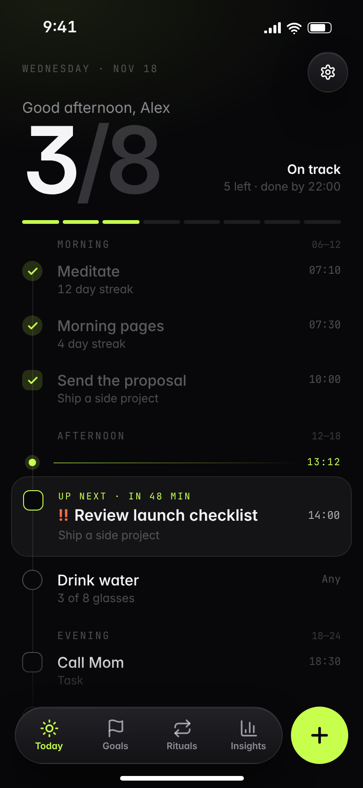

# Sova

A native iOS app for **daily tasks, goals and routines**, built with SwiftUI and iOS 26's **Liquid Glass**.

## Design

Inspired by Opal, Arc and Linear: dark-first, confident and precise.

- **Near-black canvas, one electric accent.** Lime by default (Coral, Ice, Violet and Mint are the alternatives). The accent marks only what matters: progress, selection, "now" and the create button. One faint glow per screen is the signature moment.
- **Big, tight type.** SF Pro Display for the hero numbers (the day score, goal percentages, consistency) and SF Mono for small uppercase details, times and counts.
- **Today as a timeline.** Rituals and tasks merge into one line through Morning, Afternoon and Evening, plus Overdue and Anytime. A live "now" marker shows where you are, and an **Up next** card highlights the one thing that deserves attention. Round markers are rituals; square markers are tasks.
- **Quiet surfaces, glass where it floats.** Content sits on near-transparent cards with hairline edges. Liquid Glass is used for the tab bar (with a separated "+" create button), toolbar buttons, sheets, notifications and the undo bar.
- **Details:** a check that draws itself, milestone nodes on goal progress lines, a 17-week activity heatmap, inline highlighting of what quick capture understood, haptics throughout, and an owl mascot that blinks, follows your finger and smiles when you're done.



## Onboarding

Eight short steps. Each has one idea, a staggered blur-in reveal, and drifting washes of color that change mood per step. Swipe right to go back.

1. **Welcome.** The owl inside slowly turning orbit rings (its eyes follow your touch), with "Own your days." set in large type.
2. **Three kinds of intention.** Fanned cards explain Today, Always and Someday. The example task is live, so tick it.
3. **Your name**, with a live preview of your greeting.
4. **Rituals.** Tactile tiles; each one you pick becomes a real routine.
5. **One goal for this season.** Write your own or tap a suggestion. It's created with a 90-day horizon.
6. **Reminders.** A preview of the real notification, then morning and evening times. The system permission prompt only appears after you choose "Turn on reminders".
7. **Pick your color.** A preview of *your* first day (your rituals, your goal) recolors live as you choose an accent.
8. **All set.** A summary of what was created; the owl hops and smiles.

Onboarding creates only what you choose; there is no sample or placeholder data. Inside the app, TipKit carries on teaching: first quick capture, then swiping.

## Everyday UX

- **Quick capture.** The "+" in the tab bar opens a small sheet that reads natural language as you type and highlights the date and priority it found: `Call Mom tomorrow 6pm !!` becomes a high-priority task due tomorrow at 6 PM. Return adds the task and keeps the field open for the next one.
- **Swipe actions.** On Today's timeline, swipe right to finish a task or ritual, and swipe left to push a task to tomorrow or delete it.
- **Undo, everywhere.** Completing, moving or deleting a task shows a brief Undo bar floating above the tab bar.
- **Settings.** Change your name, accent and reminder times, replay the welcome, or erase all data.

## Features

| Tab | What it does |
| --- | --- |
| **Today** | A greeting, a progress ring for the day, a row of routine buttons to tick off, tasks due today or earlier (sorted by priority), your focus goal, upcoming tasks and a list of what you finished today |
| **Goals** | Goal cards with an emoji, gradient progress and a deadline countdown. The detail screen has milestones (progress is calculated from them) or a manual progress slider, plus linked tasks and archiving |
| **Routines** | Habits grouped by Morning, Afternoon, Evening and Anytime. Each has a weekday schedule, a streak 🔥 and the last 7 days as dots. A week strip at the top shows a completion ring for each day |
| **Insights** | Swift Charts for the last 7 days, tasks completed this week, your best streak, 30-day routine consistency and average goal progress |

Data is stored only on the device, with **SwiftData**.

## Requirements

- Xcode 26 or later
- iOS / iPadOS 26 or later (Liquid Glass APIs)

## Run

1. Open `Sova.xcodeproj`.
2. Choose your team under *Signing & Capabilities*.
3. Run on an iPhone simulator or a device.

The project uses Xcode's synchronized folders, so files you add under `Sova/` are picked up automatically. If you prefer [XcodeGen](https://github.com/yonaskolb/XcodeGen), a `project.yml` is included.

## Structure

```
Sova/
  App/          entry point, root TabView, router for sheets and tabs
  Models/       SwiftData models (TaskItem, Goal, Milestone, Routine), sample data
  Theme/        color tokens, accents, themes, typography, canvas, surfaces, button styles
  Components/   owl mark, checkbox, progress, grouped list, empty state, settings menu
  Support/      natural-language parsing, reminders, task actions with undo, TipKit tips
  Features/     Onboarding, Capture, Today, Goals, Routines, Insights, Editors, Settings
```
